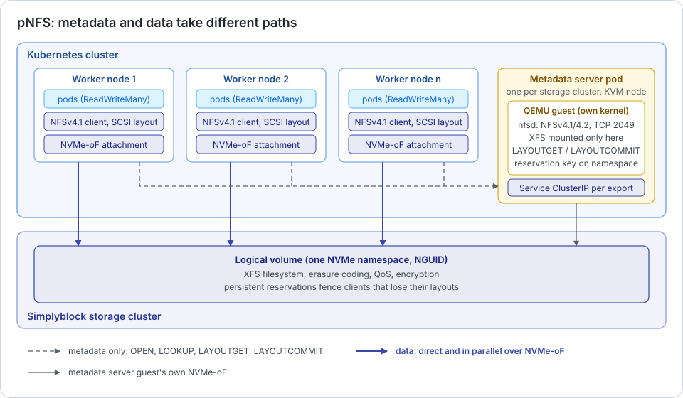
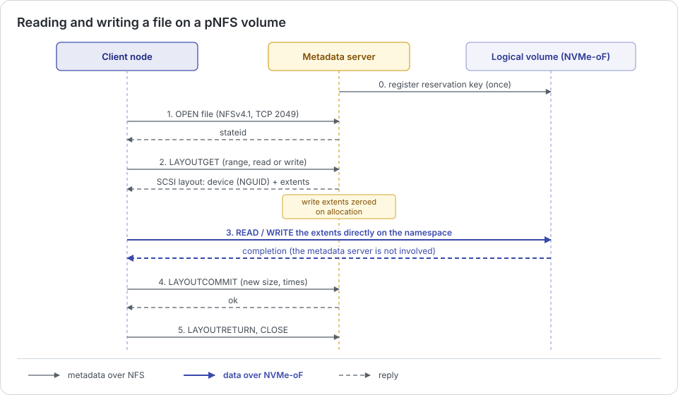

# Distributed File Storage

**Experimental**{.chip-experimental}

A simplyblock logical volume is a block device. A block device carries a filesystem that only one host may mount at a
time, which is enough for most databases and stateful services but not for workloads that share files between many
nodes: content repositories, build caches, AI training data, shared home directories, or the disks of virtual machines
that live-migrate between hosts. For those, simplyblock provides distributed file storage through parallel NFS
(pNFS).

pNFS is the extension of NFSv4.1 that separates file **metadata** from file **data**:

- **Metadata** (opening a file, looking up a name, creating a directory, allocating space) is handled by one metadata
  server (MDS). It owns the filesystem and is the only host that mounts it.
- **Data** (reading and writing file contents) does not pass through the metadata server. Each client reads and
  writes the blocks of a file directly on the simplyblock logical volume, over its own NVMe/TCP connection.

A classic NFS server sits in the data path of every client, so all clients together are limited by one server's CPU,
memory, and network. With pNFS, the metadata server only hands out the location of the data, and the data path of
each client is the same NVMe/TCP path a block volume uses. Throughput therefore scales with the number of clients and
storage nodes, and a shared volume performs close to the same logical volume attached as a block device.

## How It Works

A pNFS volume is an ordinary simplyblock logical volume that carries an XFS filesystem. Every node that runs a pod
using the volume does two things:

1. It attaches the logical volume over NVMe/TCP, exactly like a block volume.
2. It mounts the volume's export over NFSv4.1 from the metadata server, through a stable Kubernetes Service address.

The metadata server runs in a small virtual machine with its own Linux kernel and NFS server, so no Kubernetes node
runs an NFS server or needs NFS packages. It attaches the same logical volume over its own NVMe/TCP connection,
formats it on first use, and serves every pNFS volume of its storage cluster.

The layout type simplyblock uses is the pNFS SCSI layout (RFC 8154). A layout names a block device, identified by the
NGUID of the volume's NVMe namespace, and the extents of a file on it. Before handing out any layout, the metadata
server registers a persistent-reservation key on the namespace. Persistent reservations are what allow the metadata
server to fence a client that lost its layouts, so that its writes are refused by the storage cluster itself.

## A File Read and Write, Step by Step

1. **Open:** The client opens the file on the metadata server over NFSv4.1 (TCP port 2049).
2. **Layout:** The client asks for a layout of the range it reads or writes (`LAYOUTGET`). The metadata server answers
   with the device (the namespace's NGUID) and the extents. For a write, it allocates the extents and zeroes them, so
   that a write is durable as soon as it has completed on the device.
3. **Direct I/O:** The client reads and writes those extents directly on its NVMe/TCP attachment of the logical
   volume. The metadata server is not involved, and every client does this in parallel.
4. **Commit:** After writing, the client reports the new file size and times to the metadata server
   (`LAYOUTCOMMIT`).
5. **Return and close:** The client returns the layout (`LAYOUTRETURN`) and closes the file.

A client that cannot use a layout, for example, because its kernel lacks the pNFS block layout driver, still mounts the
volume. NFSv4.1 then sends its data through the metadata server instead: every byte stays correct, but throughput is
limited by the metadata server. The direct path can be verified per node, as described in
[Verifying the Direct Data Path](../../kubernetes/usage/pnfs.md#verifying-the-direct-data-path).

## What a Shared Volume Inherits

Because a pNFS volume is a simplyblock logical volume, everything that applies to a logical volume applies to the
data of a shared volume:

- **Data protection:** Erasure coding or replication across storage nodes and failure domains.
- **Performance and QoS:** The NVMe/TCP data path, and the volume and pool QoS limits (see
  [Performance and QoS](../storage-performance-and-qos.md#shared-file-storage-at-block-performance-pnfs)).
- **Encryption:** Volume encryption applies as to a block volume.
- **Snapshots and expansion:** A snapshot of a pNFS volume is a crash-consistent snapshot of its logical volume, and
  expansion grows the logical volume and the filesystem online.

## Where to Go Next

- [ReadWriteMany (pNFS)](pnfs.md) describes the components in detail: the metadata server, export addresses, the
  data path, restarts, and security.
- [ReadWriteMany Volumes](../../kubernetes/usage/pnfs.md) describes how pNFS is enabled and used on Kubernetes.
- [Deployment Architectures](../../deployment-preparation/deployment-architectures.md#shared-file-storage-pnfs)
  describes where the metadata server runs in each architecture.
- The node requirements are listed in [Hardware Requirements](../../deployment-preparation/hardware-requirements.md#virtualization-support-for-pnfs)
  and [Software Requirements](../../deployment-preparation/software-requirements.md#pnfs-requirements).

Striping one shared volume across several logical volumes, and creating a pNFS volume from a snapshot or another
volume, are not available yet.
