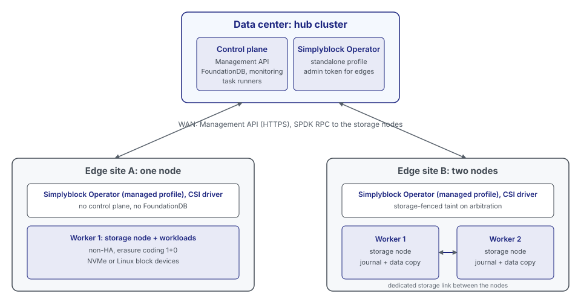

# Edge Clusters

An edge cluster is a small simplyblock storage cluster at an edge site, such as a branch office, a factory, or a
store. It consists of one or two storage nodes on the Kubernetes cluster of the site. The edge cluster does not run a
control plane of its own. It is managed by a central simplyblock control plane on a hub cluster in the datacenter,
which can manage many edge clusters.

## Components

| Component                         | Runs on      | Role                                                                                                                       |
|-----------------------------------|--------------|----------------------------------------------------------------------------------------------------------------------------|
| Control plane                     | Hub cluster  | Holds the state of every edge storage cluster in FoundationDB, exposes the Management API, and orchestrates storage nodes. |
| Simplyblock Operator (standalone) | Hub cluster  | Installs and operates the control plane on the hub.                                                                        |
| Simplyblock Operator (managed)    | Edge cluster | Discovers workers and devices, creates the storage cluster through the hub, and maintains the CSI configuration.           |
| CSI driver                        | Edge cluster | Provisions and attaches volumes for the workloads of the site.                                                             |
| Storage nodes                     | Edge workers | Serve the volumes over NVMe-oF from local NVMe devices or Linux block devices.                                             |

The hub follows the centralized model described in [Control Plane and Operator](control-plane-and-operator.md). It
can be the same cluster that runs the simplyblock Disaster Recovery hub.

## Control and Data Flow

- **Edge to hub:** The operator at the edge reaches the Management API of the hub over HTTPS. It registers the storage
  cluster, creates its storage nodes and pools, and reads their state. It authenticates with a bearer token.
- **Hub to edge:** The control plane reaches every storage node of every edge on the storage node API and the storage
  node RPC ports. It configures and monitors the storage nodes and runs restarts and recovery.
- **Data path:** Volume I/O stays at the edge. Workloads reach the storage nodes of their own site over NVMe-oF.
  Volume data never crosses the WAN.

Storage at the edge keeps serving I/O while the WAN link to the hub is down. Management operations, such as creating
a volume, and automatic recovery actions of the control plane wait until the link is back.

## High Availability

### One-Node Edge Clusters

A one-node edge cluster has a single storage node and is declared as such (cluster mode `Single`). It is not highly
available: if the node fails, its volumes are unavailable until the node is back. Applications that must survive the
loss of the node need a two-node edge cluster or application-level replication.

Within the node, the cluster still protects against device failures. Erasure coding places every chunk of a stripe
on a different device of the node, so any supported scheme can be used as long as the node has one device per chunk:

| Scheme | Minimum devices | Device failures the data survives |
|--------|-----------------|-----------------------------------|
| 1+0    | 1               | 0                                 |
| 1+1    | 2               | 1                                 |
| 2+1    | 3               | 1                                 |
| 4+1    | 5               | 1                                 |
| 1+2    | 3               | 2                                 |
| 2+2    | 4               | 2                                 |
| 4+2    | 6               | 2                                 |

The journal has its own protection, which depends on where it is placed:

- **Journal partitions (NVMe devices, the default):** The journal is mirrored across the devices of the node: two
  devices form a mirror (RAID 1), more devices form a mirror of two striped groups (RAID 0+1). The journal survives
  the failure of any one device. Two devices failing at the same time are only survived if both are in the same
  group, so a one-node cluster with 1+2, 2+2, or 4+2 is guaranteed to survive one device failure at a time, not
  two at once.
- **Dedicated journal device (`enableJournalDevice`, always used with Linux block devices):** The journal is on one
  device and is not mirrored. A failure of that device stops the node, whatever the erasure-coding scheme.

After a device failure, the data of the failed device is rebuilt onto the remaining devices of the node. This data
migration runs in relaxed placement, which places chunks without the anti-affinity a larger cluster enforces, so it
needs no second node. The remaining devices need enough free capacity to hold the rebuilt data.

### Two-Node Edge Clusters

!!! note
    Two-node edge clusters require two-node arbitration support in the control plane, the Simplyblock Operator, and
    the storage nodes.

A two-node edge cluster (cluster mode `Dual`) uses the erasure-coding scheme 1+1 on exactly two storage nodes and
keeps a copy of the journal and the data on each node. Every volume has a primary on one node and a secondary on the
other, and a workload connects to both over two NVMe-oF paths. When a node fails, the other node takes over
leadership, the active path switches, and I/O continues after a short pause.

A device failure on either node is survived as well: the other node holds a copy of the data and of the journal.
Data migration after a device failure or after adding a device runs in relaxed placement, so it needs no third node.

With only two nodes, a broken link between the nodes looks the same to each node as a failed peer. To prevent both
nodes from writing on their own (split brain), the control plane on the hub acts as the third vote:

- **Hold:** A node that loses the connection to the journal of its peer holds its write I/O for a short time
  (2.5 seconds by default, below the host keep-alive timeout) and reports the event to the hub.
- **Decision:** When one node is lost, the hub grants the surviving node solo operation. When both nodes are
  reachable but cannot reach each other (a broken link between them), the hub fences both nodes by default. With
  host fencing (see [Coordination with Kubernetes](#coordination-with-kubernetes)), it keeps one node instead: the
  node that leads more volume groups, and on a tie the one with the lower node ID. A node whose data is still being
  rebuilt never wins. A fenced node returns the held I/O as a path error, so the hosts retry on the other path.
- **Leases:** Each node holds a lease from the hub. A lease only matters while a node holds I/O. A slow or broken
  link to the hub never fences a healthy pair.
- **No grant, no solo operation:** A node that has no grant from the hub when the hold time ends fences itself. If
  neither node reaches the hub nor the other node, both nodes fence themselves, and I/O resumes once the hub is
  reachable again.
- **Workload restart:** The Kubernetes node of a fenced storage node is tainted with `storage.simplyblock.io/fenced`
  (effect `NoExecute`) by the operator, so that its pods are evicted. The taint is removed once the cluster is back
  to normal. With host fencing, the workloads of the losing node also restart on the surviving node within seconds,
  as described in the next section.

#### Availability of the Hub

The arbitration runs in the control plane on the hub, so a failover of a two-node edge cluster needs a reachable
hub. A surviving node never continues on its own, because it cannot tell a failed peer from a broken link. This
trades availability for consistency: without the hub as the third vote, a broken link could leave both nodes writing.

| Situation                                    | Behavior                                                                                                            |
|----------------------------------------------|---------------------------------------------------------------------------------------------------------------------|
| A node fails, hub reachable                  | The surviving node is granted solo operation. I/O pauses for about 0.5 to 2 seconds.                                |
| A node fails, hub not reachable              | The surviving node fences itself when the hold time ends. Volumes are unavailable until the hub is reachable again. |
| The hub is not reachable, both nodes healthy | No effect. An expired lease never fences a healthy node.                                                            |
| The link between the nodes breaks            | Both nodes are fenced, or with host fencing one node is kept. After the link is restored, the node rejoins.         |
| A host loses its path to one node            | The host switches to the other path (NVMe multipathing). No hub involvement.                                        |
| Two-node cluster without arbitration         | The surviving node continues on its own, without protection against split brain.                                    |

A node failure during an outage of the hub therefore means downtime. The control plane of the hub has to run highly
available, or in a third failure domain that must not share power, network, or location with the two edge nodes.

### Coordination with Kubernetes

On a two-node edge cluster, the storage nodes and the workloads share the same two Kubernetes nodes. When the hub
fences one node, the storage on that node stops, but Kubernetes does not know it. The Kubernetes node can still be
`Ready`. If it is unreachable instead, Kubernetes waits several minutes before it gives up on its pods, and it never
starts a pod elsewhere on its own while the pod's volume is still attached to the unreachable node. Host fencing
closes this gap. The storage decides, and Kubernetes follows the decision.

The decision cannot be left to Kubernetes alone. A Kubernetes node that has lost its storage may still run its pods
and virtual machines. Starting a second instance of such a workload on the other node is only safe if the first one
can no longer write. Fencing the storage on the losing node is not enough for that: a host keeps an NVMe-oF path to
each storage node, so a workload on the losing node could keep writing through the surviving node. Host fencing
therefore cuts the losing host off from the surviving node, at the storage target, before Kubernetes acts.

| Step | Component                             | Action                                                                                                                                         |
|------|---------------------------------------|------------------------------------------------------------------------------------------------------------------------------------------------|
| 1    | Hub (arbiter)                         | Grants the surviving node solo operation and fences the losing node. Volume I/O continues on the surviving node.                               |
| 2    | Hub (control plane)                   | Revokes every NVMe host identity of the losing Kubernetes node on the volumes of the surviving node and disconnects its controllers.           |
| 3    | Simplyblock Operator                  | Sets the node condition `StorageFenced=True` on the losing Kubernetes node.                                                                    |
| 4    | NodeHealthCheck                       | Detects the condition and creates a `StorageFenceRemediation` for the node.                                                                    |
| 5    | Simplyblock Operator                  | Confirms the fence with the hub and applies the taint `node.kubernetes.io/out-of-service` (non-graceful node shutdown), without power fencing. |
| 6    | Kubernetes, KubeVirt                  | Force-delete the pods, force-detach the volumes, and start the workloads and virtual machines on the surviving node.                           |
| 7    | Hub, Simplyblock Operator             | After the storage has healed, the node is `Ready`, and no pod from before the fence is left on it, the hub gives the host its access back.     |
| 8    | Simplyblock Operator, NodeHealthCheck | The condition turns `False`, the remediation is deleted, and the taint is removed. The node takes workloads again.                             |

The order of the steps is what makes it safe. Kubernetes starts a second instance of a workload only after the hub has
revoked the host of the first one (step 2 before step 3), and the host gets its access back only after every pod from
before the fence is gone from it (step 7). The pods of the storage nodes tolerate the out-of-service taint, because the
losing node heals through them.

A host is fenced only when its state is unknown: the node is silent, the link between the nodes is broken, or an
administrator overrode the arbiter. Kubernetes restarts nothing when only the storage service of a node is affected,
because the workloads on that node keep running through the path to the other node:

| Event on one node                                           | Host fenced                     | Workloads restarted on the other node |
|-------------------------------------------------------------|---------------------------------|---------------------------------------|
| Node powered off or hung, or its operating system crashed   | Yes                             | Yes                                   |
| Link between the nodes broken, both nodes reach the hub     | Yes (the node that is not kept) | Yes                                   |
| Storage node process crashed, Kubernetes node healthy       | No                              | No                                    |
| Planned restart or shutdown of the storage node             | No                              | No                                    |
| Node lost its connection to the hub, still reaches its peer | No                              | No                                    |

The out-of-service taint force-detaches every volume of the node, also volumes of other storage drivers, which the
hub cannot fence. The remediation therefore refuses to taint a node with a volume of another CSI driver attached,
unless the remediation template allows it.

Host fencing is off by default and turned on per cluster, see
[Deploying Edge Clusters](../../kubernetes/installation/edge-clusters.md#host-fencing). Without it, a fenced node only
carries the `storage.simplyblock.io/fenced` taint. Pods on an unreachable node then wait for Kubernetes' own handling
of an unreachable node, and a broken link between the nodes fences both nodes.

### Host Connection Settings

Hosts connect to a two-node edge cluster with arbitration using settings that the control plane sets and the CSI driver
applies: an NVMe keep-alive timeout of 2 seconds, so that a frozen storage node is detected within a few seconds, a fast
I/O failure timeout of 8 seconds, longer than the hold time, and a controller loss timeout of 3600 seconds, so that a
path to a fenced node is retried instead of dropped. Other clusters, including two-node clusters without arbitration,
keep their settings.

## Network Paths

| Path                   | Between                        | Purpose                                                   | Required for           |
|------------------------|--------------------------------|-----------------------------------------------------------|------------------------|
| Management uplink      | Edge workers and the hub       | Management API, storage node API, storage node RPC        | All edge clusters      |
| Storage network        | Edge workers and their clients | NVMe-oF volume traffic                                    | All edge clusters      |
| Link between the nodes | The two storage nodes          | Journal and data replication, second path besides the hub | Two-node edge clusters |

For a two-node edge cluster, the link between the nodes and the management uplink must not share a switch, a cable,
or a network interface. Otherwise, a single failure cuts both paths at the same time, and the hub cannot tell a
failed node from a broken link.

The edge-specific requirements are noted in [Hardware Requirements](../../deployment-preparation/hardware-requirements.md)
and [Software Requirements](../../deployment-preparation/software-requirements.md), the deployment is described in
[Deploying Edge Clusters](../../kubernetes/installation/edge-clusters.md), and the operation in
[Operating Edge Clusters](../../kubernetes/operations/cluster/edge-clusters.md).
