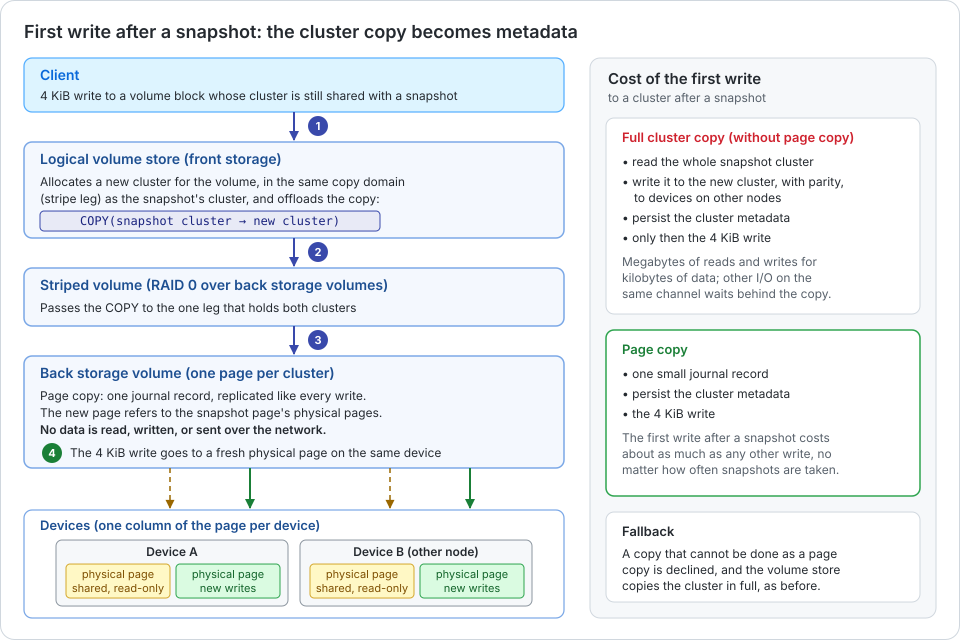
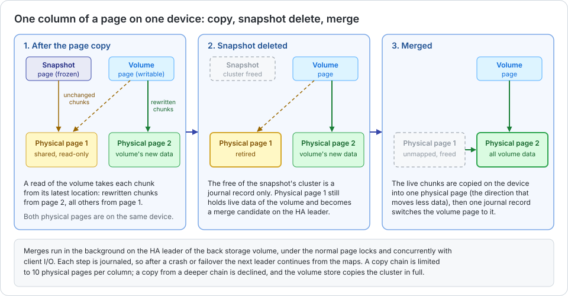

A snapshot freezes the state of a volume. The next write to a block of the volume must not change the data that the
snapshot still references, so the volume needs its own copy of that data first: copy-on-write. Simplyblock does this
copy without moving data. The logical volume store offloads it to the back storage, which records it as a page copy:
a reference to the snapshot's data, written as one small journal record. When the snapshot is deleted later, a
background merge folds the shared data back into the volume, so that snapshot chains stay short.

## Copy-on-Write in the Logical Volume Store

A logical volume is allocated in clusters of its logical volume store. After a snapshot, every cluster of the volume
is shared with the snapshot. The first write to a shared cluster allocates a new cluster for the volume, copies the
snapshot's cluster into it, and only then applies the write. Without a copy offload, this copy reads and writes the
whole cluster: a 4 KiB write after a snapshot costs megabytes of I/O, with parity, on devices of other storage
nodes. Other I/O on the same channel waits until the copy is done. With frequent snapshots under random writes, a
large share of all writes pays this price.

## Copy Offload Through the Storage Stack

The logical volume store sits on a striped volume (RAID 0) over the back storage volumes of its storage node, and each
cluster of the volume store maps onto exactly one page of a back storage volume. The copy-on-write passes through this
stack in four steps.

The numbers in the figure match the steps.

1. **Logical volume store:** It allocates the new cluster in the same copy domain as the snapshot's cluster, that is,
   on the same leg of the striped volume, and sends a `COPY` request instead of reading and writing the data.
2. **Striped volume:** It passes the `COPY` through to the leg that holds both clusters.
3. **Back storage:** It performs a page copy. One journal record makes the volume's new page refer to the physical
   pages of the snapshot's page on every device. No data is read, written, or sent between nodes. The journal record
   is replicated like every other write, so the copy survives a failover.
4. **Write:** The 4 KiB write of the client goes to a fresh physical page on the same device. A physical page that is
   referenced by more than one page is read-only. A read of the volume takes every chunk from its latest location:
   the rewritten chunks from the new physical page, all others from the shared one.

If a copy cannot be done as a page copy, the back storage declines it, and the logical volume store falls back to
the full copy of the cluster. This happens, for example, if the two clusters are on different legs of the striped
volume, or if the copy chain of the source is already long (see below).

Page copies inherit the placement of their source: the shared data and the volume's new data of a column are on the
same device. The erasure coding, the anti-affinity of the columns across storage nodes and failure domains, and
therefore the fault tolerance are the same as for any other data. Rebalancing keeps such columns where they are, as
long as their devices are online and the anti-affinity holds.

## Merge on Snapshot Delete

Without a cleanup, every snapshot would add one more physical page per column to the pages it was copied to, and
reads and rebalancing would have to follow ever longer chains. The back storage therefore merges the data back when
a snapshot is deleted.

A merge has three phases.

- **Retire:** Deleting the snapshot frees its clusters. For a physical page that another page still references, the
  free is a journal record only, and the physical page becomes a merge candidate.
- **Merge:** The HA leader of the back storage volume copies the live chunks of the shared physical page and the
  volume's own physical page into one of the two, in the direction that moves less data. The copy stays on the
  device, without network traffic. One journal record then switches the volume's page, and every other page that
  refers to the moved data, to the remaining physical page.
- **Free:** A physical page without references is unmapped on its device, and its capacity is free again.

Merges run in the background, under the normal page locks and concurrently with client I/O. Every merge step is
journaled and planned again from the current state, so a crash, a restart, or a failover in the middle of a merge
leaves a consistent volume, and the new leader continues the merge. A merge that fails, for example, because a
device is unavailable during an outage, is retried after 60 seconds.

A copy chain is limited to 10 physical pages per column. A copy from a deeper chain is declined, and the full copy of
the cluster starts a new chain. With a rotation that deletes the oldest snapshot of a volume after each new one, the
merges keep a chain at about the number of kept snapshots plus one.

## Benefits

- **Cheap copy-on-write:** The first write to a cluster after a snapshot costs one small journal record and the write
  itself, instead of a full read and write of the cluster with parity across the network.
- **Stable latency with frequent snapshots:** The write after a snapshot no longer waits for a cluster copy, and no
  other I/O queues behind one. Short snapshot intervals, snapshot schedules, and snapshot-based
  [replication](../../disaster-recovery/index.md) no longer cost write performance.
- **Less load on the network and the devices:** The copy moves no data between storage nodes and writes no data to
  the devices, which saves bandwidth and device endurance.
- **Cleanup on the device:** A snapshot delete is merged locally on each device in the background, without network
  traffic, and keeps the chains short.
- **Same semantics and protection:** Snapshots and clones behave exactly as before. The page copy is part of the
  replicated journal and covered by the same erasure coding, failover, and crash consistency as every other write.

## Limitations

- **Capacity:** Page copy saves I/O, not capacity. The volume's new physical page is allocated as a whole on its
  first write, as with a full copy. The capacity of a retired physical page is freed once it is merged.
- **Activation:** Page copy is enabled for a storage cluster when the cluster is created (`--enable-page-copy`). All
  storage nodes of the cluster must run a version that supports it, because it uses new journal record types.
- **Fallback:** Copies that the back storage declines (different legs of the striped volume, a copy chain at the
  limit) use the full copy of the cluster.

See [Snapshots and Clones](snapshots-clones.md) for the behavior of snapshots and clones as seen by the user.
