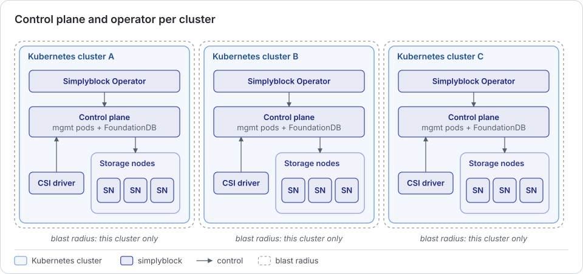
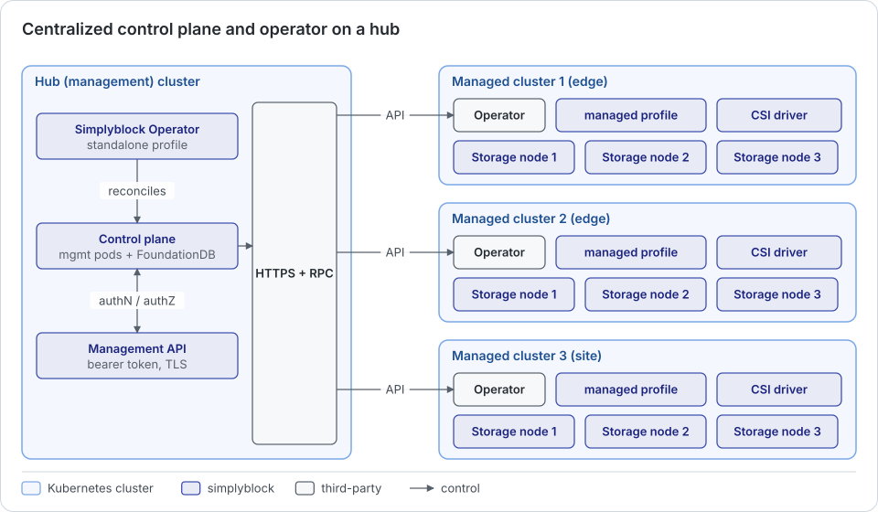

The simplyblock control plane holds the state of the storage clusters, exposes the Management API, and orchestrates
the storage nodes. The Simplyblock Operator reconciles the simplyblock custom resources into control plane calls.
Both can be deployed locally on every Kubernetes cluster that consumes or provides simplyblock storage, or centrally
on a hub cluster that manages the storage of many Kubernetes clusters. The choice is independent of the storage
placement (hyper-converged, disaggregated, or hybrid).

## Local Control Plane and Operator

In the local model, every Kubernetes cluster runs its own control plane (management pods and FoundationDB), its own
Simplyblock Operator, the CSI driver, and the storage nodes of its storage clusters. The operator is installed with
the `standalone` profile. See
[Control Plane Cluster Architecture](../../kubernetes/installation/management-cluster-architecture.md).

Characteristics of the local model:

- **Isolation:** Every cluster is managed independently. Configuration, credentials, and custom resources of one
  cluster are not visible to another one.
- **Small blast radius:** A failure or misconfiguration of a control plane affects only the storage clusters of its
  own Kubernetes cluster.
- **Independent upgrades:** Each cluster upgrades its control plane, operator, and storage nodes on its own
  schedule.
- **No cross-cluster dependency:** Storage provisioning and failover handling in a cluster do not depend on the
  availability of any other cluster or of a wide-area network link.

The cost of the local model is that every cluster carries a full control plane, including a three-node FoundationDB
cluster, and that every cluster is operated separately. For a small number of medium or large clusters, this is
rarely a concern. For a large number of small clusters, the per-cluster footprint and the operational effort grow
with the number of clusters.

A single local control plane can manage more than one storage cluster. See
[Deployment Architectures](../../deployment-preparation/deployment-architectures.md) for a Kubernetes cluster with
several storage clusters.

## Centralized Control Plane and Operator on a Hub

In the hub model, a hub (management) cluster runs the simplyblock control plane, installed by an operator with the
`standalone` profile. The managed Kubernetes clusters run no control plane and no FoundationDB. They run the
Simplyblock Operator with the `managed` profile, the CSI driver, and the storage nodes. A single hub control plane
manages the storage clusters of many managed clusters.

- **Managed cluster to hub:** The operator of a managed cluster reaches the Management API of the hub over HTTPS and
  authenticates with a bearer token. It discovers the workers and devices of its cluster, creates the storage
  cluster, its storage nodes, and pools through the hub, and maintains the CSI configuration.
- **Hub to managed cluster:** The hub control plane reaches the storage nodes of every managed cluster on the storage
  node API and RPC ports. It configures and monitors them and runs restarts and recovery.
- **Data path:** Volume I/O stays within each managed cluster. Volume data never passes through the hub.

Characteristics of the hub model:

- **Central management of many clusters:** The storage clusters of all managed clusters are held and observed by one
  control plane. This suits fleets of many small clusters, for example, [edge clusters](edge-clusters.md).
- **Minimal footprint on managed clusters:** Managed clusters do not run a control plane or FoundationDB, which
  frees resources on small clusters.
- **Storage keeps running without the hub:** Volumes keep serving I/O while the hub is unreachable. Management
  operations, such as creating a volume, and automated recovery wait until the hub is reachable again.

The installation is described in [Connecting to an External Control Plane](../../kubernetes/installation/install-csi.md)
and, for edge sites, in [Installing Edge Clusters](../../kubernetes/installation/edge-clusters.md).

## Comparison

| Aspect                                       | Local                                                            | Hub                                                     |
|----------------------------------------------|------------------------------------------------------------------|---------------------------------------------------------|
| Control plane location                       | Each Kubernetes cluster                                          | Hub cluster                                             |
| Components on a consuming or storage cluster | Operator, control plane, FoundationDB, CSI driver, storage nodes | Operator (`managed` profile), CSI driver, storage nodes |
| Blast radius of a management failure         | One Kubernetes cluster                                           | Management operations of all managed clusters           |
| Upgrades                                     | Per cluster                                                      | Control plane on the hub, operators per managed cluster |
| Authorization                                | Per cluster                                                      | Management API token of the hub                         |
| Dependency on other clusters                 | None                                                             | Management operations depend on the hub                 |
| Typical use                                  | Few medium to large clusters, strict isolation                   | Many small clusters, for example, edge fleets           |

## Relation to the Disaster Recovery Hub

Disaster recovery uses a hub cluster as well. The DR hub runs the Open Cluster Management hub, the Ramen hub
operator, and dr-hub, and it coordinates failover and relocation between site clusters. The DR hub works with local
control planes on the sites as well as with a centralized control plane: the same hub cluster can host both the DR
components and the simplyblock control plane.

The hub requirements are described in
[Disaster Recovery Requirements](../../deployment-preparation/dr-requirements.md), and the combinations of DR and
management topologies in [Deployment Architectures](../../deployment-preparation/deployment-architectures.md).
